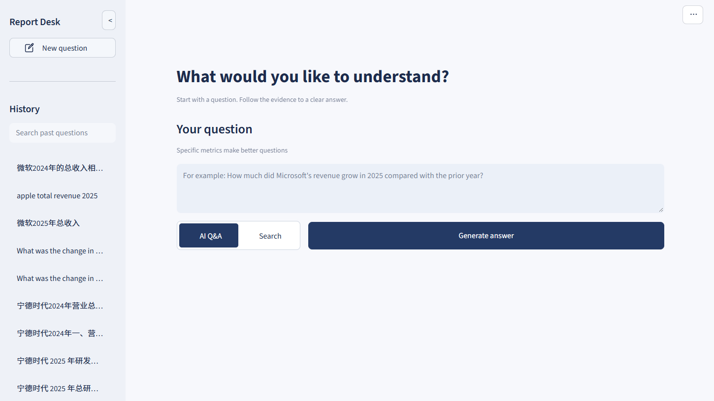
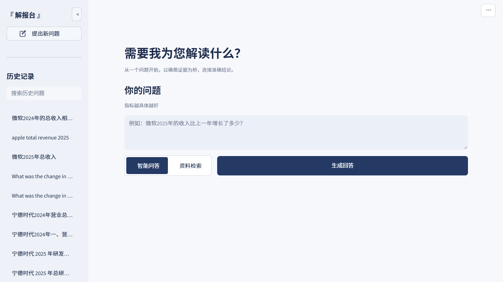
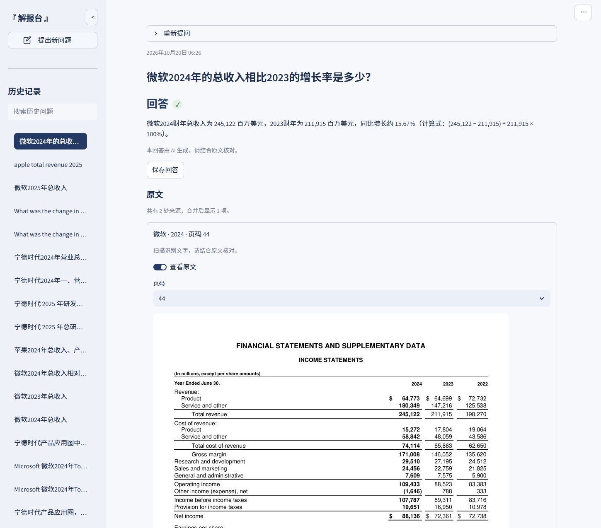
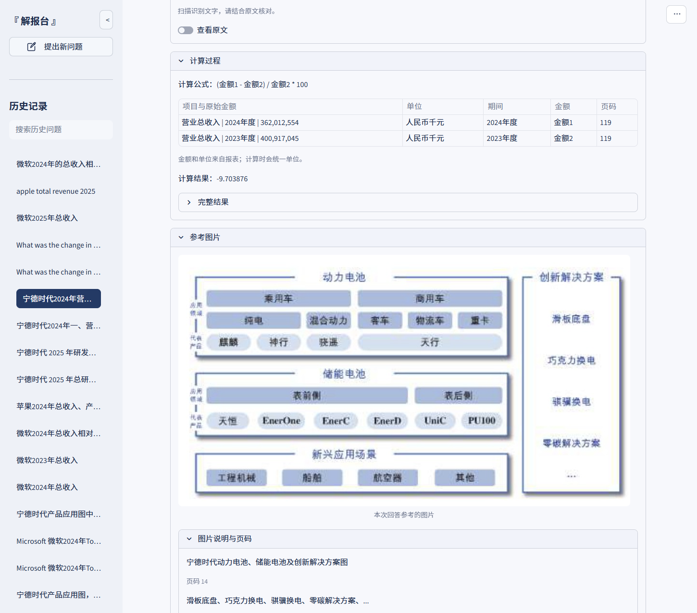

# Report Desk

A local multimodal RAG agent for searching reports and documents, answering with source references, reading images, and performing evidence-based calculations.

This is a personal-use project, published mainly as a record that the work exists.

## Basic use

The setup below targets Windows, Python 3.11, and the pinned CUDA 12.6 PyTorch wheels. Install [uv](https://docs.astral.sh/uv/getting-started/installation/), then run these commands from the project folder in PowerShell:

```powershell
. .\scripts\session.ps1
uv python install 3.11
uv venv --python 3.11 .venv
uv pip install --python .venv\Scripts\python.exe -r requirements.lock.txt --extra-index-url https://download.pytorch.org/whl/cu126 --index-strategy unsafe-best-match
uv pip install --python .venv\Scripts\python.exe --no-deps -e .
```

Document files, models, and the local index are not included. Restore them with the commands below. The download scripts fetch the sample reports and [FinQA](https://github.com/czyssrs/FinQA), plus [Qwen3-Embedding-0.6B](https://huggingface.co/Qwen/Qwen3-Embedding-0.6B), Docling, and EasyOCR weights; parsing and indexing rebuild the local JSON/NumPy store without a database server.

```powershell
.venv\Scripts\python.exe scripts/download_sources.py
.venv\Scripts\python.exe scripts/download_models.py
.venv\Scripts\python.exe -m finrag.cli prepare-generated
.venv\Scripts\python.exe scripts/prepare_corpus.py
.venv\Scripts\python.exe -m finrag.cli parse
.venv\Scripts\python.exe -m finrag.cli index
```

Use **AI Q&A** to ask a question or **Search** to find source documents. On the first AI request, enter your own [DeepSeek API key](https://platform.deepseek.com/) in the password dialog; the app stores it locally. Model, endpoint, and spending limits are configured in `configs/runtime.json`.

Run the demo by double-clicking **Start Workbench.cmd** (opens `http://127.0.0.1:8503`); double-click **Stop Workbench.cmd** when finished.

## Screenshots

English home page.



Chinese home page.



An answer with its source-page preview.



Calculation details and a referenced image.


